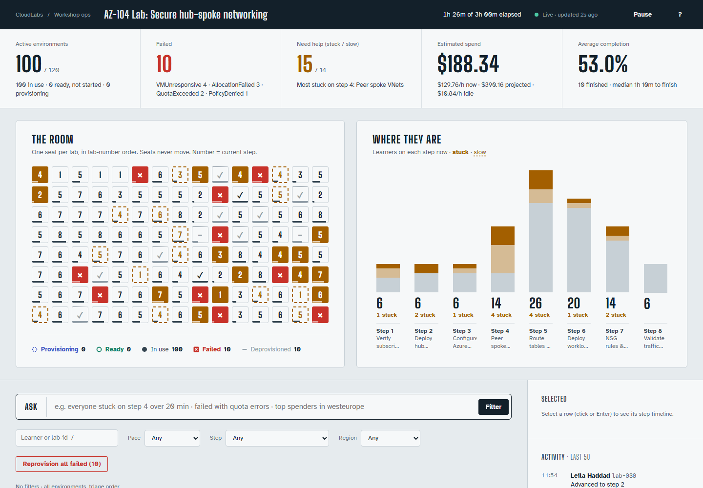
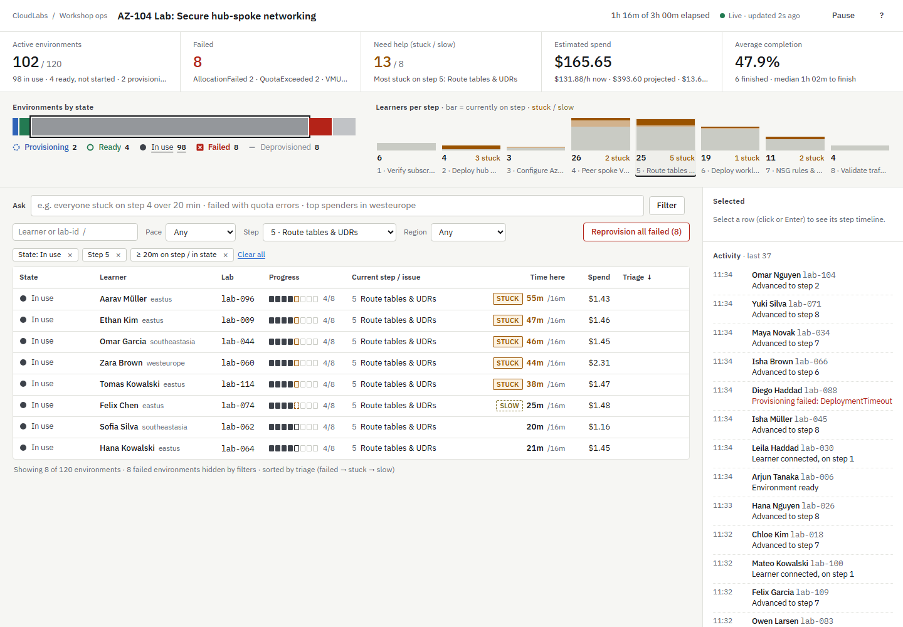
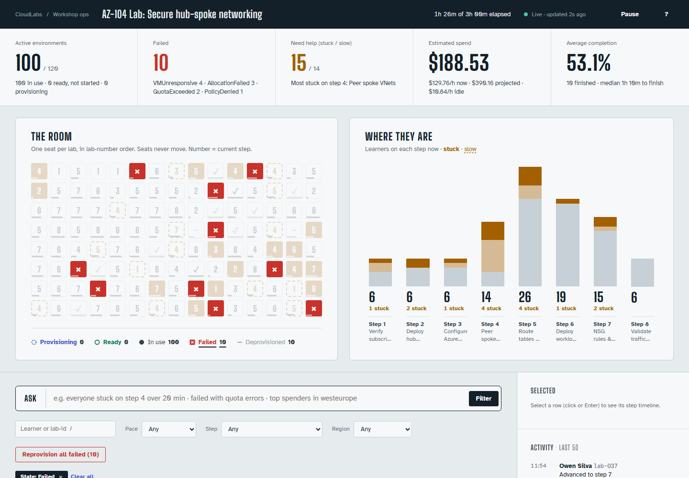
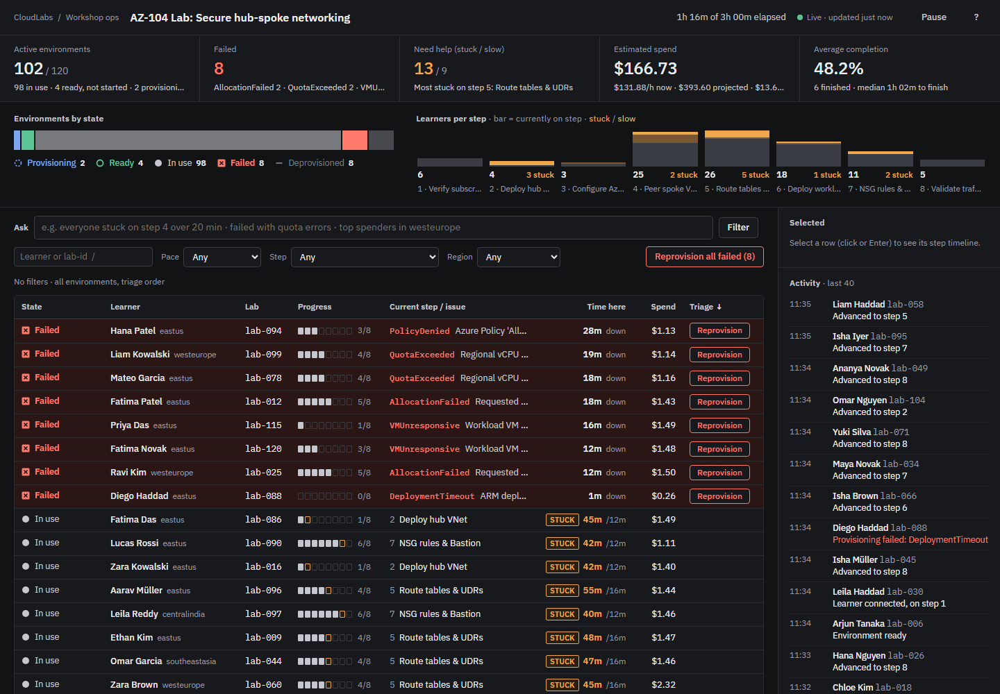
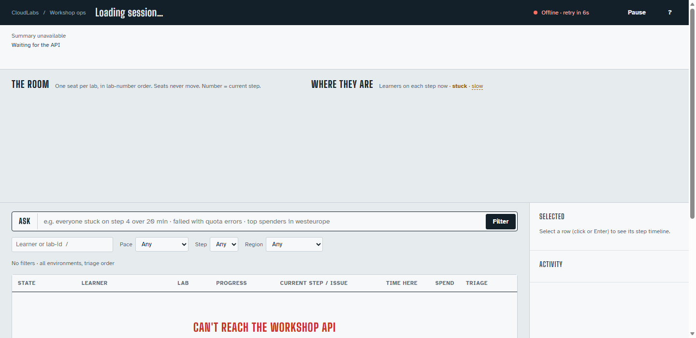

# CloudLabs Workshop Ops

One screen for an instructor running a live Azure workshop with 120 learners: which lab environments are healthy, who is stuck, what is failing, and what the session is costing.

**Live:** https://specktra-assignment.vercel.app

**Design intent:** a control-room view of the classroom. "The room" maps all 120 learners as seats in fixed lab-number order, so trouble shows up as a place ("back-left corner is red"), and the table below opens sorted by what needs a human. Colour is only spent on status: anything coloured is something to act on.



## Run it

Requires Node 20+.

```bash
npm install
```

```bash
npm start
```

Open http://localhost:4173.

The data is seeded (120 environments, fixed seed) and the server drifts it every 2 seconds, so learners advance, environments fail and finish while you watch.

Optional settings:

| Variable | Effect |
|---|---|
| `KV_REST_API_URL`, `KV_REST_API_TOKEN` | Shared state in Redis (set automatically when an Upstash Redis store is connected in Vercel). Without them, state is kept in memory. `UPSTASH_REDIS_REST_URL` / `_TOKEN` also work. |
| `ANTHROPIC_API_KEY` | Turns on the Claude-backed plain-language filter. Without it the keyword parser handles the same box. |
| `ANTHROPIC_MODEL` | Model used for the filter (default `claude-opus-5-5`). |
| `AI_DISABLED=1` | Forces the keyword-parser fallback even when a key is set. |
| `SIM_SPEED=5` | Speeds drift up for demos. |
| `CHAOS_RATE=0.3` | Makes 30% of reads return 503, to watch the stale-data banner and backoff. |
| `SEED`, `PORT`, `TICK_MS` | Dataset seed, port, drift interval. |

Run the tests:

```bash
npm test
```

### Seeing every UI state

| State | How |
|---|---|
| Dense (all 120 rows) | Default view |
| Loading | http://localhost:4173/?simulate=slow (API waits 2.5 s) |
| Error, no data yet | http://localhost:4173/?simulate=error |
| Error, with stale data kept on screen | `CHAOS_RATE=0.5 npm start`, or stop the server while the page is open |
| Empty, no environments | http://localhost:4173/?simulate=empty |
| Empty, filters match nothing | Ask "failed in centralindia over 200 min" |

## What is on the screen

1. **Summary ledger.** Active, failed (with top error codes), need help (stuck / slow), spend (now, burn per hour, projected at session end, idle burn), and average completion. Failed and Need help are buttons that filter the table.
2. **The room and the step funnel.** Every learner as a seat in lab-number order: the number is their current step, a filled amber seat is stuck, a dashed amber border is slow, red with × is failed, a dashed blue outline is provisioning, a teal ring is ready, ✓ is finished. Seats never move between polls. Filters dim the seats that don't match, clicking a seat opens that learner, and arrow keys move across the grid. The funnel next to it shows how many learners are on each step, split into on-pace / slow / stuck. Clicking a state or step filters the table.
3. **Ask box.** Plain-language filter, for example "everyone stuck on step 4 over 20 min". It compiles to the same filter chips the manual controls produce, and says whether Claude or the keyword fallback compiled it.
4. **Table.** One row per environment, shape and text for status, 8-pip step progress, time on the current step against the expected time, spend, and a Reprovision action on failed rows. Rows flash briefly when their state or step changes.
5. **Side panel.** Step timeline for the selected learner (actual against expected per step) and a live activity feed.

Keyboard: `J`/`K` move, `Enter` details, `R` reprovision, `F` failed only, `S` slow + stuck, `/` search, `A` ask, `P` pause, `Esc` clear, `?` help.

Filters live in the URL hash, so a view such as `#states=failed` can be bookmarked or shared.

## API

| Method | Path | Notes |
|---|---|---|
| GET | `/api/environments` | `states`, `steps`, `pace`, `regions`, `failureCodes`, `minOnStepMin`, `maxOnStepMin`, `minSpend`, `q`, `sort`, `dir`. Filtering, triage sort and spend all happen here. |
| GET | `/api/summary` | Counts by state, pace, failure codes, spend (total, burn rate, idle burn, wasted on failed, projected), completion, per-step funnel with median time. |
| GET | `/api/events?since=` | Activity log written by the simulator and by mutations. |
| POST | `/api/environments/reprovision` | `{ "ids": [...] }`. Only `failed` environments move to `provisioning`; anything else is reported per id. 409 if none qualified. |
| POST | `/api/nl-filter` | `{ "text": "..." }` returns `{ filter, source: "model" or "rules", explanation, degradedReason? }`. |

## Deploying to Vercel

The repo deploys as-is: `public/` is served as static files and `vercel.json` routes every `/api/*` request to `api/handler.js`.

For state that every serverless instance shares (so a reprovision shows up for everyone):

1. In the Vercel project, open **Storage → Create → Upstash for Redis** (the replacement for Vercel KV) and connect it to this project.
2. Redeploy. The connection adds `KV_REST_API_URL` and `KV_REST_API_TOKEN`, and `GET /api/summary` then reports `"store": "redis"`.

Without a store the deployment still works, but each instance keeps its own copy in memory.

## Layout

```
server/workshop.js   data model, seed, drift, query, aggregation, spend, mutation
server/nlfilter.js   plain-language filter: Claude + keyword fallback
server/api.js        JSON API, shared by local server and Vercel
server/store.js      shared state: Redis when configured, memory otherwise
server/index.js      local server: API + static files (node:http, no framework)
api/handler.js       Vercel function entry (vercel.json routes /api/* here), wraps server/api.js
public/              index.html, app.css, app.js (no build step, no framework)
test/                node:test suite for spend math, mutation, filters, fallback
docs/                screenshots
```

See [DECISIONS.md](DECISIONS.md) for the reasoning and [AI_NOTES.md](AI_NOTES.md) for where an AI assistant was and was not used.

## Screenshots

| | |
|---|---|
|  |  |
|  |  |
